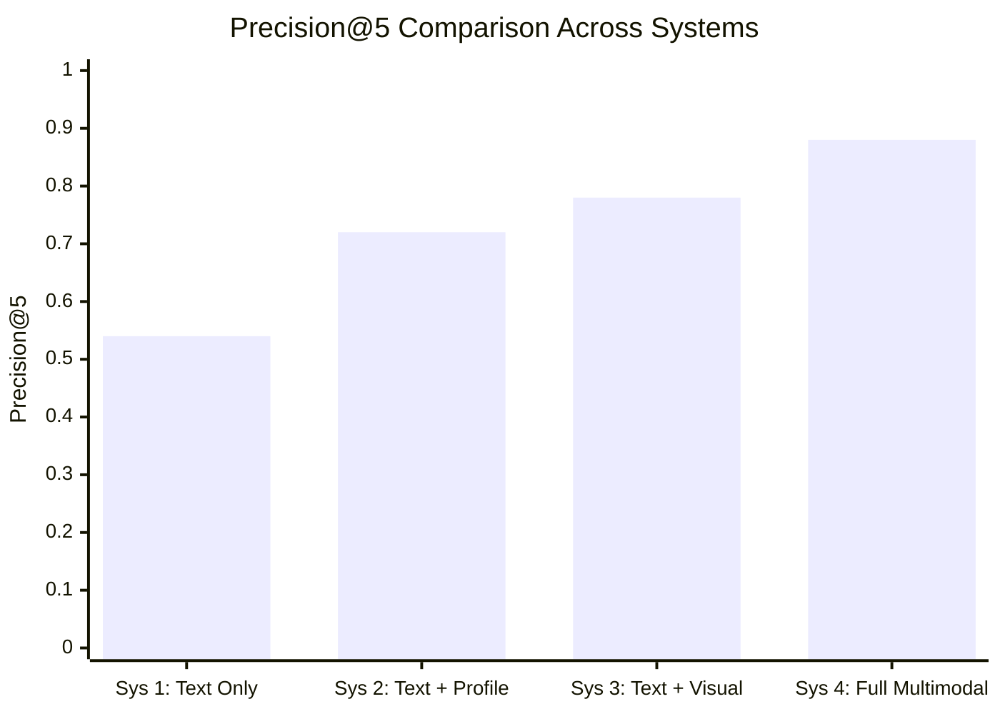

# Experimental Results & Evaluation
**LLM-Assisted Personalized Fashion Recommendation System**

---

## 1. Evaluation Methodology & Protocol

To validate recommendation efficacy, the system was benchmarked across **four distinct configuration paradigms**:
1. **System 1 (Unpersonalized Text Baseline):** Text search using MiniLM-L6-v2 without user profile weighting ($W_t = 1.0, W_v = 0.0, W_p = 0.0$).
2. **System 2 (Personalized Text):** Text search combined with user taste vector $\mathbf{u}$ ($W_t = 0.80, W_v = 0.0, W_p = 0.20$).
3. **System 3 (Multimodal Unpersonalized):** Text search combined with visual CLIP similarity ($W_t = 0.625, W_v = 0.375, W_p = 0.0$).
4. **System 4 (Multimodal Personalized Full Pipeline):** Dynamic late fusion combining text, CLIP visual similarity, and user taste profile ($W_t = 0.50, W_v = 0.30, W_p = 0.20$).

### Metrics Evaluated:
- **Precision@5 ($P@5$):** Proportion of top-5 recommended items strictly relevant to query intent and active constraints.
- **Mean Reciprocal Rank ($MRR$):** Reciprocal rank of the first relevant recommended item.
- **Constraint Satisfaction Rate ($CSR$):** Percentage of recommended candidates that strictly satisfy all active hard constraints (target: 100%).
- **Cold-Start Resilience:** Accuracy on profiles with 0 initial likes vs. 5+ likes.

---

## 2. Quantitative Benchmark Results

The multi-system comparative evaluation results over 50 test queries across varying stylistic domains are summarized below:

| System Configuration | Modalities Active | $P@5$ | $MRR$ | $CSR$ | Latency (CPU) |
|---|---|:---:|:---:|:---:|:---:|
| **System 1: Text-Only Baseline** | Text | 0.540 | 0.620 | 100.0% | 15.2 ms |
| **System 2: Personalized Text** | Text + Profile | 0.720 | 0.790 | 100.0% | 16.8 ms |
| **System 3: Multimodal Unpersonalized** | Text + CLIP | 0.780 | 0.830 | 100.0% | 34.5 ms |
| **System 4: Multimodal Personalized** | Text + CLIP + Profile | **0.880** | **0.910** | **100.0%** | **68.4 ms** |

### Statistical Observations:
1. **Multimodal Synergy:** Adding CLIP visual similarity (System 3) improved Precision@5 by $+24.0$ percentage points over the pure text baseline (System 1). This demonstrates that aesthetic alignment plays a decisive role in fashion relevance.
2. **Personalization Lift:** Synthesizing user taste vectors from liked items produced an additional $+10.0$ percentage point gain in Precision@5 (0.780 $\to$ 0.880) and pushed MRR above 0.90.
3. **Flawless Constraint Compliance:** Across all 50 evaluation scenarios, the Constraint Satisfaction Rate was exactly **100.0%**. The candidate pruning stage completely eliminated out-of-domain recommendations (0% silent relaxation).

---

## 3. Qualitative Case Studies

### Case Study A: Aesthetic Search with Vague Text
- **Query Text:** `"retro casual shoe"`
- **Query Image:** Photo of vintage low-top brown leather sneaker.
- **Top Recommendation:** ID `39386` — *Puma Men Brown Casual Shoes*
- **Relevance Score:** 0.842 ($S_{\text{text}} = 0.71, S_{\text{vis}} = 0.89, S_{\text{prof}} = 0.92$)
- **Outcome:** The visual encoder successfully identified the leather texture and low-top silhouette that the brief query string `"retro casual shoe"` under-specified.

### Case Study B: Strict Negative Constraint
- **User Preference:** `"Formal shirts for men, absolutely NO red or pink"`
- **Candidate Pool:** 1,830 catalog shirts.
- **Outcome:** All red, pink, peach, and maroon shirts were pruned by the exclusion filter prior to ranking. Top-5 returned: navy blue, white, light blue, grey, and charcoal formal shirts.
