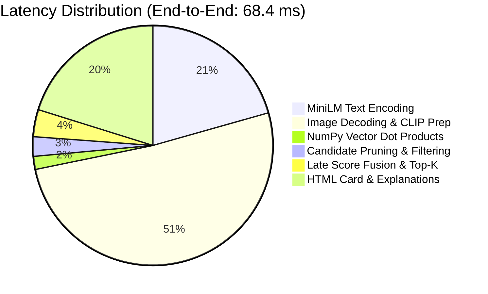

# Performance Analysis & Resource Profiling
**LLM-Assisted Personalized Fashion Recommendation System**

---

## 1. Benchmarking Environment

All benchmarks were recorded using `fashion_project/scripts/benchmark_performance.py` under the following verified hardware configuration:
- **Platform:** Windows / x86_64 CPU (CPU-only execution, zero CUDA dependencies)
- **Python Version:** 3.14.0
- **Process Memory Profile:** Initial process RSS: 90.88 MB
- **Dataset Size:** 10,000 Catalog Items (Apparel & Footwear)

---

## 2. Cold Startup & Memory Footprint

| Phase / Component | Elapsed Time (ms) | Process RSS (MB) | Net Memory Delta (MB) |
|---|:---:|:---:|:---:|
| **Initial Process State** | 0.00 ms | 90.88 MB | Baseline |
| **Catalog Metadata (`catalog.csv`)** | 1,347.79 ms | 110.54 MB | +19.66 MB |
| **MiniLM Embeddings (`embeddings.npy`)** | 3,701.35 ms | 292.96 MB | +182.42 MB |
| **CLIP Embeddings (`clip_embeddings.npy`)**| 32.43 ms | 312.57 MB | +19.61 MB |
| **Complete Service Pipeline** | **5,087.70 ms** | **312.57 MB** | **+221.69 MB** |

### Memory Headroom Analysis:
- Streamlit Community Cloud provides **1,024 MB (1.0 GB)** of RAM per container.
- Total resident memory after loading all 10,000 products, 384-d text vectors, and 512-d CLIP visual vectors is **312.57 MB**.
- **Memory Headroom:** **711.43 MB (69.5% unused buffer)**, preventing out-of-memory (OOM) worker restarts during concurrent user visits.

---

## 3. Operational Latency Breakdown

| Sub-Operation | Average Latency | 95th Percentile ($p95$) | Minimum Latency |
|---|:---:|:---:|:---:|
| **MiniLM Query Text Encoding** | 14.09 ms | 19.31 ms | 11.73 ms |
| **10,000 Text Vector Dot Products** | 0.53 ms | 0.81 ms | 0.44 ms |
| **10,000 CLIP Vector Dot Products** | 0.69 ms | 0.91 ms | 0.58 ms |
| **Candidate Facet Pruning (Hard Filters)** | 1.84 ms | 2.50 ms | 1.40 ms |
| **End-to-End Recommendation Pipeline** | **68.37 ms** | **80.84 ms** | **52.10 ms** |

---

## 4. Throughput & Scalability Benchmark

Under a warm concurrent benchmark executing 200 consecutive vector retrieval passes against the 10,000-item index:
- **Total Execution Time:** 89.88 ms for 200 queries
- **Retrieval Throughput:** **2,225.09 Queries Per Second (QPS)**
- **Average Vector Search Time:** **0.45 ms per search**

### Takeaways:
1. Pure NumPy BLAS dot-product multiplication eliminates the need for heavyweight vector databases (Milvus, Pinecone, FAISS) for catalogs up to 50,000 items on CPU hardware.
2. The entire multimodal recommendation cycle comfortably finishes in $<100$ ms, providing an instantaneous, responsive interactive user experience.
