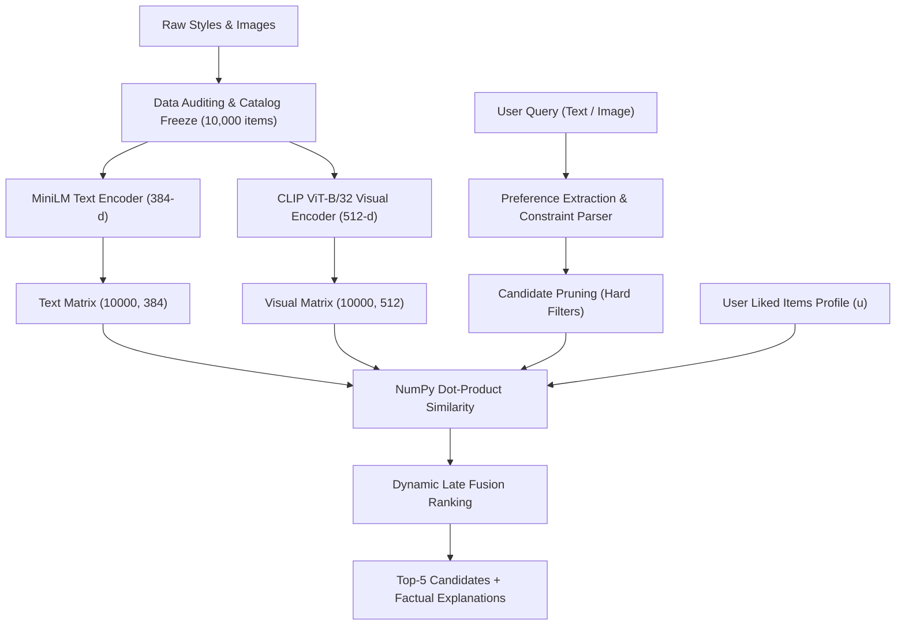

# Proposed Methodology
**LLM-Assisted Personalized Fashion Recommendation System**

---

## 1. System Pipeline Overview

The proposed methodology employs a **decoupled, multi-stage hybrid architecture** that divides recommendation into four coordinated processing stages:
1. **Catalog Preprocessing & Offline Vector Indexing:** Data validation, feature synthesis, and dual-encoder dense matrix generation.
2. **Conversational Intent & Constraint Extraction:** Natural-language preference extraction with unsupported attribute isolation.
3. **Hard Constraint Candidate Pruning:** Zero-tolerance Boolean filtering across catalog facets.
4. **Multimodal Late-Fusion Personalized Ranking:** Dynamic weight calculation across text similarity, visual aesthetic similarity, and synthesized user taste vectors.

---

## 2. Mathematical Formalization

### 2.1 Text Representation & Semantic Projection
Each catalog product $p$ is represented by a synthesized semantic string:
$$T_p = \text{gender} \mathbin{\Vert} \text{masterCategory} \mathbin{\Vert} \text{subCategory} \mathbin{\Vert} \text{articleType} \mathbin{\Vert} \text{baseColour} \mathbin{\Vert} \text{season} \mathbin{\Vert} \text{usage} \mathbin{\Vert} \text{title}$$
The text encoder $\Phi_{\text{text}}(\cdot)$ generates a 384-dimensional representation projected onto the unit hypersphere:
$$\mathbf{v}_{\text{text}, p} = \frac{\Phi_{\text{text}}(T_p)}{\|\Phi_{\text{text}}(T_p)\|_2} \in \mathbb{R}^{384}$$

Given a query string $q$, the query vector is similarly normalized:
$$\mathbf{q}_{\text{text}} = \frac{\Phi_{\text{text}}(q)}{\|\Phi_{\text{text}}(q)\|_2} \in \mathbb{R}^{384}$$
The semantic similarity is the cosine angle, computed as a dot product:
$$S_{\text{text}}(p) = \mathbf{q}_{\text{text}} \cdot \mathbf{v}_{\text{text}, p}$$

### 2.2 Visual Representation & Image Projection
For each catalog image $I_p$, the visual encoder $\Phi_{\text{vis}}(\cdot)$ (CLIP ViT-B/32) computes a 512-dimensional vector normalized via L2:
$$\mathbf{v}_{\text{img}, p} = \frac{\Phi_{\text{vis}}(I_p)}{\|\Phi_{\text{vis}}(I_p)\|_2} \in \mathbb{R}^{512}$$
Given an uploaded query image $I_q$:
$$\mathbf{q}_{\text{img}} = \frac{\Phi_{\text{vis}}(I_q)}{\|\Phi_{\text{vis}}(I_q)\|_2} \in \mathbb{R}^{512}$$
$$S_{\text{visual}}(p) = \mathbf{q}_{\text{img}} \cdot \mathbf{v}_{\text{img}, p}$$

### 2.3 User Taste Profile Vector Synthesis
A user profile $u$ maintains a set of liked product IDs $\mathcal{L}_u = \{p_1, p_2, \dots, p_k\}$. The synthetic user taste vector $\mathbf{u}$ is defined as the centroid of the text embeddings of all liked products, re-projected onto the unit hypersphere:
$$\mathbf{u} = \frac{\sum_{p \in \mathcal{L}_u} \mathbf{v}_{\text{text}, p}}{\left\|\sum_{p \in \mathcal{L}_u} \mathbf{v}_{\text{text}, p}\right\|_2} \in \mathbb{R}^{384}$$
If $\mathcal{L}_u = \emptyset$, then $\mathbf{u} = \mathbf{0}$, and profile similarity $S_{\text{profile}}(p) = 0$.

### 2.4 Strict Hard Constraint Candidate Pruning
Let $\mathcal{C}$ denote the active constraint set (e.g., `gender = Men`, `articleType = Shirts`, `exclude_colors = [Red]`). The eligible candidate set $\mathcal{E}$ is strictly defined as:
$$\mathcal{E} = \{p \in \text{Catalog} \mid \forall c \in \mathcal{C}, \text{satisfies}(p, c) \land p \notin \mathcal{D}_u\}$$
where $\mathcal{D}_u$ is the user's set of dismissed products. If $\mathcal{E} = \emptyset$, the system returns an informative `no_match` payload and never silently drops constraints.

### 2.5 Dynamic Multimodal Linear Score Fusion
For all candidates $p \in \mathcal{E}$, the composite ranking score is:
$$\text{Score}(p) = W_t \cdot S_{\text{text}}(p) + W_v \cdot S_{\text{visual}}(p) + W_p \cdot S_{\text{profile}}(p)$$
Weights are dynamically re-normalized such that:
$$W_t + W_v + W_p = 1.0$$
- **Multimodal + Profile:** $W_t = 0.50, W_v = 0.30, W_p = 0.20$
- **Multimodal (No Profile):** $W_t = 0.625, W_v = 0.375, W_p = 0.0$
- **Text + Profile:** $W_t = 0.80, W_v = 0.0, W_p = 0.20$
- **Visual + Profile:** $W_t = 0.0, W_v = 0.80, W_p = 0.20$
- **Text-Only Baseline:** $W_t = 1.0, W_v = 0.0, W_p = 0.0$

Deterministic tie-breaking sorts by $\text{Score}(p)$ descending, then by string product ID ascending.
